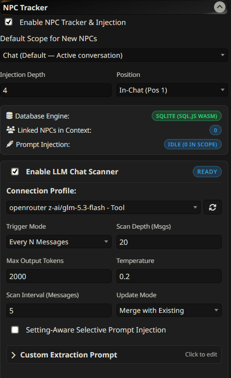
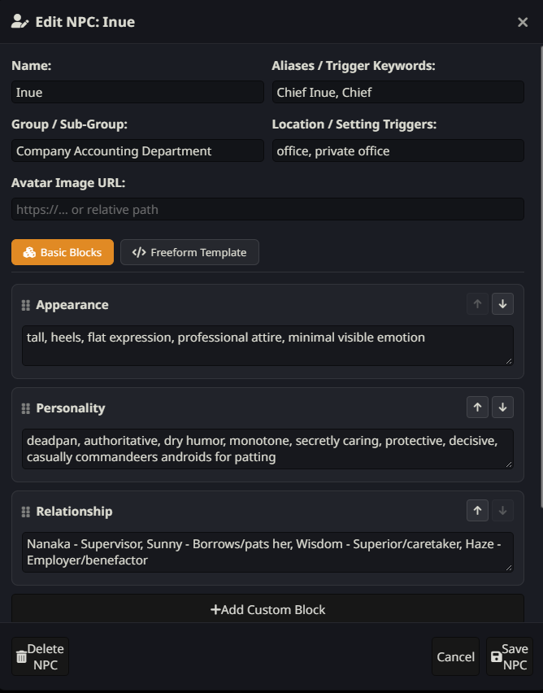

# SillyTavern NPC Tracker

A lightweight, focused in-browser NPC database and dynamic prompt injection extension for [SillyTavern](https://github.com/SillyTavern/SillyTavern).

Do you love having recurring secondary characters in your stories? Tired of tracking them manually through sprawling World Info lorebooks? Don't want the clunkiness of full group chats or bloated character cards?

**NPC Tracker** is designed to do one job and do it well: keep track of your Non-Player Characters, store their details in a fast local SQLite database, and dynamically inject them into your prompt only when they are relevant to the scene.

---

## 📦 Installation

1. In SillyTavern, open the **Extensions** menu (the cube icon in the top navigation bar).
2. Click **Install Extension**.
3. Paste the repository URL:
   ```text
   https://github.com/rinchannow02/SillyTavern-NPC-tracker
   ```
4. Click **Install** and confirm. Reload SillyTavern if prompted.

---

## ✨ Features

- **Robust In-Browser SQLite Database:** Runs on pure client-side WebAssembly (`sql.js`) and persists automatically to IndexedDB via `localforage`. No Node.js server dependencies or external databases required.
- **Multi-Scope Scoping:** Link NPCs to an active **Chat**, **Character**, **User Persona**, or **Global** scope so characters only appear in the stories they belong to.
- **Dynamic Sheet Editor:**
  - **Modular Block Mode:** Reorderable, customizable attribute blocks (Appearance, Personality, Relationships, or custom details).
  - **Freeform Template Mode:** Full Markdown and Handlebars support (`{{name}}`, `{{group}}`, `{{location}}`, `{{appearance}}`, etc.) for complete formatting control.
- **Automated LLM Chat Scanner:**
  - Automatically analyzes recent dialogue to extract newly introduced or updated NPCs.
  - Can be triggered manually, periodically ("Every N Messages"), or on keyword matches.
  - Flexible API routing: use your active SillyTavern API or route extraction through any dedicated SillyTavern **Connection Profile** (e.g., lightweight, cost-effective models).
  - Fine-grained controls: customizable extraction prompt, adjustable sampling temperature, and configurable output token limits.
- **Setting-Aware Selective Injection:**
  - Optionally filters prompt injection based on the current scene setting (compound Place + NPC triggers).
  - Keeps your context window lean by only injecting NPCs when their location keywords, name, or aliases match the recent conversation.
- **Full Data Portability:** One-click JSON database export and import for seamless backups and sharing between devices.

---

## 📸 Screenshots

<details>
<summary><b>Click to expand screenshots</b></summary>

<br>

### NPC Tracker Settings & Scanner Panel
Configure scan depth, connection profile routing, trigger intervals, and view active NPCs linked to your current context.



### NPC Sheet Editor Modal
Edit physical traits, demeanor tags, pairwise character relationships, and assign scope links.



</details>

---

## 💡 Why I Built This

I enjoy having living worlds populated with recurring side characters, but existing solutions didn't quite fit my workflow:
- **Group Chats:** Often feel clunky and awkward for incidental characters who only pop in for a few lines.
- **Multi-Character Cards:** Stuffing multiple character definitions into a single character card rapidly bloats the context window with information that isn't relevant to the current scene.
- **World Info / Lorebooks:** Great for static world lore, but cumbersome for tracking fluid character details, relationship changes, and dialogue-driven updates.

NPC Tracker provides a focused middle ground: a dedicated manager that records who characters are, updates them as the story progresses, and injects their profiles into the prompt only when they are physically present.

---

## ⚙️ Recommended Setup & Best Practices

### 1. Dedicated Connection Profile for the Scanner
For the best speed, lowest latency, and zero token waste, set up a separate Connection Profile in SillyTavern specifically for the scanner:

> **TL;DR Model Recommendations:**
> - **Cloud APIs:**
>   - **Gemini 1.5 / 2.0 Flash:** Ultra-fast, near-zero cost, and a massive context window for reading deep chat histories.
>   - **Claude 3.5 Haiku:** Best-in-class character nuance, relationship detection, and zero conversational fluff.
>   - **GPT-4o-mini:** Rock-solid JSON schema adherence at low latency.
> - **Local / Self-Hosted (Ollama / LM Studio / KoboldCpp):**
>   - **Qwen 2.5 (7B / 14B Instruct):** The gold standard for open-weight structured JSON and entity extraction.
>   - **Phi-4-mini (3.8B) / Llama 3.2 (3B):** Extremely lightweight; runs effortlessly on laptops and low-VRAM setups.
> - **⚠️ Thinking / Reasoning Models (`DeepSeek R1`, `GLM-Flash`, `Qwen-Thinking`):**
>   - **Disable reasoning effort** (`off` / `none`) in the model's preset whenever possible. Reasoning models spend 1,000–3,000 tokens on internal monologue before writing any JSON.
>   - If reasoning cannot be disabled, increase **Max Output Tokens** in the scanner settings to `4000+` so the reasoning chain does not exhaust the token budget before outputting the JSON payload (`finish_reason: length`).
> - **Recommended Sampler Preset:** Set **Temperature to `0.1`–`0.2`** and **Frequency Penalty to `0.0`** for deterministic, schema-compliant output.

### 2. Complementary Extensions
- [SillyTavern-Extension-NPCNames](https://github.com/elana-voss/SillyTavern-Extension-NPCNames): Helps keep NPC names unique and creative, preventing the LLM from constantly reusing generic names like "Tanaka" or "Marcus."

---

## 🧭 Alternatives

This extension is deliberately built with a tight, focused scope for NPC profile management and contextual injection. If you are looking for broader automated scene summarization or automated World Info generation, consider these comprehensive extensions:
- [SillyTavern-MemoryBooks](https://github.com/aikohanasaki/SillyTavern-MemoryBooks)
- [SillyTavern-WorldInfo-Recommender](https://github.com/bmen25124/SillyTavern-WorldInfo-Recommender)

---

## 🤝 Contributing

Contributions, suggestions, and bug reports are welcome! Feel free to open an issue or submit a pull request on GitHub.

---

## 📄 License

This project is licensed under the [MIT License](LICENSE).